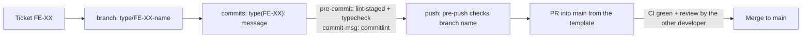

# Contributing

Every change belongs to a ticket (FE-XX). The rules below are checked by Git hooks, so a wrong branch name or commit message is rejected on your machine before it reaches GitHub.

Start here: [`docs/development/`](docs/development/README.md) (setup, features, extending guide, deployment) and the [UI guide](docs/ui-guide/README.md).



## Branches

`type/FE-XX-short-name`, all lowercase, words joined by `-`.

- Types: `feat`, `fix`, `chore`, `refactor`, `test`, `docs`
- Examples: `feat/FE-02-sign-in`, `fix/FE-03-otp-timer`
- `main` is the only other name allowed.

A Husky `pre-push` hook (`scripts/check-branch-name.sh`) rejects any other branch name. Rebase on `main` every morning.

## Commits

`type(FE-XX): message`

- Same types as branches. The ticket ID is required and goes in the brackets.
- Write the message in the imperative, with no full stop: `feat(FE-02): add phone sign-in`.
- Header at most 100 characters.
- Small commits: one change each.

Hooks (never skip them with `--no-verify`):

| Hook         | Runs                                                                                      |
| ------------ | ----------------------------------------------------------------------------------------- |
| `pre-commit` | `lint-staged` (ESLint + Prettier on staged files) and `npm run typecheck`                 |
| `commit-msg` | commitlint (`commitlint.config.js`): rejects a bad type, a missing ticket ID, a full stop |
| `pre-push`   | Branch-name check                                                                         |

## Pull requests

- One PR per ticket into `main`, under about 400 lines, reviewed by the other developer. Shared folders (`ui/`, `config/`, `docs/openapi.json`) change in small separate PRs.
- The PR template (`.github/pull_request_template.md`) asks for:
  - **Ticket**
  - **What changed**
  - **Screenshots (EN + HI)**: the screen in English and in Hindi
  - **Mocked / pending backend**: anything running on mocks or with no backend yet (also add it to `docs/open-items.md`)
  - **Checklist**: tested on a phone (Expo Go), `npm run i18n:check` passes, tests pass
- CI (`.github/workflows/ci.yml`, Node 22) must be green before merging. It runs, in order: `npm ci`, `npm run lint`, `npm run format:check`, `npm run typecheck`, `npm test -- --ci`, `npm run i18n:check`, `npm run build:web`.

## Before you push

```bash
npm run check && npm run format:check && npm run build:web
```

(`npm run check` is lint, typecheck, tests and `i18n:check`; the other two are also in CI.)

## Docs you must keep up to date

| When you...                          | Update                                                                           |
| ------------------------------------ | -------------------------------------------------------------------------------- |
| Connect or add an API endpoint       | `docs/integration.md` status table; `docs/openapi.json` + `npm run api:generate` |
| Postpone anything or mock something  | `docs/open-items.md` (and mark the code `// PENDING BACKEND`)                    |
| Finish, change or postpone a feature | `docs/development/02-features.md`                                                |
| Change env variables                 | `.env.example`, `docs/development/01-local-setup.md`                             |
| Change builds or hosting             | `docs/development/04-deployment.md`                                              |
| Add a colour, token or component     | `docs/ui-guide/README.md`                                                        |

Docs are Markdown in the repo, with diagrams as Mermaid code blocks (GitHub renders them), so they are versioned and tagged with the code.

## What is enforced and what is not

| Rule                                                                                                      | Enforced by                                                             |
| --------------------------------------------------------------------------------------------------------- | ----------------------------------------------------------------------- |
| Branch and commit names, ticket ID                                                                        | Husky hooks (on your machine); CI does **not** re-check commit messages |
| Lint, Prettier, types, tests, English/Hindi keys, no hard-coded JSX text                                  | pre-commit (lint-staged, typecheck) and CI                              |
| Screens (`app/`) must not import `openapi-fetch`, `expo-secure-store` or `react-native-ble-plx`           | ESLint `no-restricted-imports` in `eslint.config.js`                    |
| "caregiver", "household", tokens-only colours, same button size, `// PENDING BACKEND` marks, docs updated | **Review only**: check them in the PR                                   |

Hooks are local: after a fresh clone run `npm install` (the `prepare` script installs Husky). The pre-commit typecheck runs on the whole project, so it can take a while; that is expected.

## Project rules

See `CLAUDE.md` and the [extending guide](docs/development/03-extending.md): use the words "caregiver" and "household" (the backend's word "circle" appears only in `services/household/`, `services/mocks/` and the household store that reads server data), keep button size the same in both themes, put every string in `i18n/en.json` and `i18n/hi.json`, keep API calls in `services/`, mark mocked endpoints `// PENDING BACKEND`, and use the real lowercase error codes from `docs/openapi.json`.
