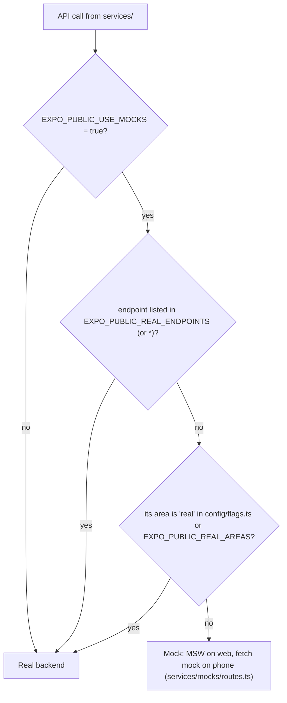

# 1. Local setup

## Requirements

- Node 22 (CI uses 22) and npm. The repo has `.npmrc` with `legacy-peer-deps=true`; keep it.
- A phone with **Expo Go** (quickest), or Xcode / Android Studio, or an EAS development build (see [Deployment](04-deployment.md)).
- Git. `npm install` also installs the Husky hooks (the `prepare` script).

## First run

```bash
git clone <repo-url> && cd Svaraa_v0_general
npm install
cp .env.example .env      # then edit; see below
npm start                 # Expo Go: scan the QR code
```

| Command                   | What it does                                                                   |
| ------------------------- | ------------------------------------------------------------------------------ |
| `npm start`               | Dev server for Expo Go (`expo start --go`)                                     |
| `npm run ios` / `android` | Dev server, opens a simulator / emulator                                       |
| `npm run web`             | Browser, Expo's default port (8081)                                            |
| `npm run web:server`      | Browser on **port 5173**, the only origin the Render dev backend allows (CORS) |
| `npm run start:dev`       | Dev server for a development build (needed for native modules, see below)      |
| `npm run check`           | lint + typecheck + tests + i18n check (run before every push)                  |
| `npm run build:web`       | Static web export to `dist/` (what CI builds)                                  |
| `npm run api:generate`    | Regenerate `services/api/schema.d.ts` from `docs/openapi.json`                 |

After changing `.env`, restart with `--clear`: `npx expo start --clear` (values are inlined at build time).

`app/index.tsx` routes by sign-in state: signed out → `/welcome`; Google user without a phone → `/add-phone`; new user → `/intro`; otherwise
`/home`. The component demo (every component, both themes, both languages) is at the route `/components` (`app/(dev)/components.tsx`).

## Expo Go versus a development build

Expo Go only has Expo's bundled native modules. These need a **development build** (`eas build --profile development`):

- Google sign-in on phones (`@react-native-google-signin`)
- Real push token (needs an EAS project id)
- Real Bluetooth (not wired yet), background location "Always", game sounds via `expo-audio`, background audio

Everything else, including the whole mock flow, works in Expo Go and the browser.

## `.env`

Copy `.env.example` (it documents every key). `.env` is git-ignored. Everything starting with `EXPO_PUBLIC_` is **built into the app and
readable by anyone**: never put a secret there (no JWT secret, no Groq or Deepgram key).

| Variable                                                                   | Purpose                                                                                                          |
| -------------------------------------------------------------------------- | ---------------------------------------------------------------------------------------------------------------- |
| `EXPO_PUBLIC_APP_ENV`                                                      | `local`, `dev`, `staging` or `prod` (label for the build)                                                        |
| `EXPO_PUBLIC_API_URL`                                                      | Backend host **without** `/api/v1`. Render dev: `https://svaraa-backend.onrender.com`                            |
| `EXPO_PUBLIC_WS_URL`                                                       | Voice socket host (`wss://`). Empty = derived from the API URL                                                   |
| `EXPO_PUBLIC_API_TIMEOUT_MS`                                               | Default 60000: Render's free tier sleeps, first call can take 30-60 s                                            |
| `EXPO_PUBLIC_USE_MOCKS`                                                    | Master switch. Keep `true`; areas are switched to real individually. `false` sends **every** call to the server  |
| `EXPO_PUBLIC_REAL_AREAS`                                                   | Areas to send to the real server on this computer, e.g. `auth,household`                                         |
| `EXPO_PUBLIC_REAL_ENDPOINTS`                                               | Single endpoints to send to the real server, e.g. `POST /api/v1/auth/otp/request`, or `*`                        |
| `EXPO_PUBLIC_SETUP_LINK_HOST`                                              | Host of the wearer setup link (`svaraa.ai`); other hosts are ignored                                             |
| `EXPO_PUBLIC_GOOGLE_WEB_CLIENT_ID`, `_IOS_CLIENT_ID`, `_ANDROID_CLIENT_ID` | Google OAuth client IDs (public). All in the same Google Cloud project, and in the backend's `GOOGLE_CLIENT_IDS` |
| `EXPO_PUBLIC_SHOW_DEV_OTP_HINT`                                            | Shows "use 0000" under the code field. Never `true` in prod                                                      |

Backend on your own computer: use your Wi-Fi IP (`http://192.168.x.x:8000`); `localhost` does not work from a phone, and the Android
emulator uses `http://10.0.2.2:8000`.

## Mock versus real backend

Three layers decide whether one request goes to the mock or the real server (`config/env.ts` → `isMocked()`):



Areas (`config/flags.ts`): `auth`, `googleSignIn`, `household`, `notifications`, `ai` (chat), `newsApi`, `remindersApi`, `musicApi`,
`spotifyApi`, `notesApi`. All default to `'mock'`. Tests never set `EXPO_PUBLIC_REAL_AREAS`, so they always use mocks.

Typical setups:

| Goal                        | `.env`                                                                                                                  |
| --------------------------- | ----------------------------------------------------------------------------------------------------------------------- |
| Build screens, no server    | defaults (`USE_MOCKS=true`, `REAL_AREAS=` empty)                                                                        |
| Real sign-in, rest mocked   | `EXPO_PUBLIC_REAL_AREAS=auth`                                                                                           |
| Everything the server has   | `EXPO_PUBLIC_REAL_AREAS=auth,googleSignIn,ai,household,notifications,newsApi,remindersApi,musicApi,notesApi,spotifyApi` |
| Browser against real server | as above, then `npm run web:server -- --clear` (port 5173)                                                              |

Mock behaviour worth knowing: the demo one-time code is `000000` on the mock; the real dev server only accepts `0000`. A claim code
ending `-0000` is "already claimed"; on the dev server claim codes starting `MOCK` work (e.g. `MOCK-0000-0001`). Step-by-step
connection and checks: [`integration.md`](../integration.md).

## Troubleshooting

- "No connection" on every screen: check `EXPO_PUBLIC_API_URL` (no typo, no `/api/v1`), restart with `--clear`.
- Web cannot reach the real API: the backend's `CORS_ORIGINS` must include your origin (use `npm run web:server` for 5173).
- Web sign-in is kept in memory only, so reloading signs you out (by design for now).
- Commit rejected: see [Contributing](../../CONTRIBUTING.md) for the branch and message rules.
