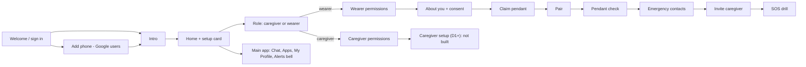

# 2. Features: status and known limits

Status key: **Done** = built and works on mocks, nothing the frontend still owes. **Partial** = usable, with named gaps.
**Next version** = not built or blocked on the backend, hardware or a development build.

"Backend" says how far the real server is checked. Today **everything defaults to mocks** (`config/flags.ts`); "checked" means
direct requests to the Render dev server worked (20-21 Nov 2026), not that it was tried end to end on a phone. Nothing is Live on a
phone yet. Per-endpoint detail: [`integration.md`](../integration.md). Every limit below is also tracked in
[`open-items.md`](../open-items.md); keep both in step.

> Status was compiled from the code, `docs/integration.md` and `docs/open-items.md` on branch `feat/FE-33-one-player-spotify-events`.
> The team should confirm the **Status** column in review: "Done" reflects what the docs say is built, not a QA sign-off on devices.

## Product flow

## Feature table

### Account and setup

| Feature                                                              | Status       | Backend                     | Known limits                                                                                                                                                     |
| -------------------------------------------------------------------- | ------------ | --------------------------- | ---------------------------------------------------------------------------------------------------------------------------------------------------------------- |
| Sign in with phone OTP (A1, A2)                                      | Done         | Live on web                 | Dev server accepts only `0000`; no real SMS provider yet. Web keeps the session in memory (reload signs out)                                                     |
| Sign in with Google                                                  | Partial      | Draft ready                 | Web works with a web client ID. Phones need a development build + Android/iOS OAuth clients; not tried with real accounts                                        |
| Add your phone (A2)                                                  | Partial      | Draft ready                 | Backend has no `mobile_number` on `/users/me`: the verified number is kept on the phone, so a new phone asks again                                               |
| Intro (A3)                                                           | Partial      | n/a                         | Placeholder illustrations; Hindi is a first draft                                                                                                                |
| Home + setup card (A4)                                               | Done         | Server checked (`/me/home`) | No name step for phone users (greeting says "Hello"); Terms and Privacy links are plain text (**needed before store release**)                                   |
| Role choice (B1)                                                     | Done         | Server checked              | Nothing saved at B1; the server creates the household at C1                                                                                                      |
| Caregiver permission (B3)                                            | Done         | Draft ready                 | Real push token needs EAS project id + device build; a placeholder token is saved on mocks                                                                       |
| Wearer permissions (B2)                                              | Partial      | Draft ready                 | Bluetooth shown as allowed (simulator). "Always" location cannot be tested in Expo Go. Android battery exemption only opens settings                             |
| About you + consent (C1)                                             | Partial      | Server checked              | Consent text is a first draft (`CONSENT_VERSION = '2026-11-v1'` in `services/household/wearerApi.ts`; `open-items.md` still says `v0`): needs legal review       |
| Claim pendant (C2)                                                   | Partial      | Server checked              | Claim code / QR format is a guess (`features/wearer/claimCode.ts`). "Already claimed" (E5), "ask the owner", second-hand flow not built                          |
| Pair + pendant check (C3, C4)                                        | Partial      | Server checked              | Pendant is the in-app **simulator**; signature format and key upgrade open with hardware team                                                                    |
| Emergency contacts (C5, C6)                                          | Done         | Server checked              | Contact limit of 5 in My Profile is a guess                                                                                                                      |
| Invite a caregiver (C7)                                              | Partial      | Server checked              | Joining with the code, pending state and owner approval not built. No "invite later" in Settings                                                                 |
| SOS drill (C8)                                                       | Partial      | Server checked              | Polls every 2 s (push would be better). Calls only open the dialer (`tel:`); automatic calling in order and 112 need a telephony backend. No real SOS screen yet |
| Caregiver setup (D1-D5), setup link, deep links, web landing (D6-D8) | Next version | n/a                         | `/setup` is a test screen. Wearer-by-link flow (B2, C3, C4, C8 only) not built                                                                                   |

### Main app

| Feature                                                  | Status       | Backend                                 | Known limits                                                                                                                                                          |
| -------------------------------------------------------- | ------------ | --------------------------------------- | --------------------------------------------------------------------------------------------------------------------------------------------------------------------- |
| Chat (text)                                              | Partial      | Contract from Render, not tried via app | Proposed actions and sample chats are mock. Older messages (`older_cursor`), >50 chats, rename/delete in UI not built                                                 |
| Chat history + sidebar/drawer                            | Partial      | As Chat                                 | Search icon only opens All chats                                                                                                                                      |
| Voice: dictation mic (web)                               | Done (web)   | None (browser speech-to-text)           | Web only                                                                                                                                                              |
| Voice: Talk call screen                                  | Partial      | `WS /voice/ws` draft ready              | Phone mic in chat disabled; the call view plays a **scripted** conversation (`services/voice/voiceSession.ts`). How the socket takes the token is not in the contract |
| Apps tab + Manage apps                                   | Done         | Choices stored on this phone            | Not per wearer, so the pendant does not follow them. Riddles switch has no app. Quiet hours not built                                                                 |
| My Profile + Edit profile                                | Partial      | Via mocked wearer/contacts endpoints    | Missing: reorder contacts, caregivers/members, pendant transfer, notification settings, consent record, delete account, help, app version                             |
| Settings: language, display size, home background, theme | Done         | Local                                   | 6 locales: `en`, `hi` full; `ta`, `zh`, `ko`, `ja` are partial first drafts (fall back to English)                                                                    |
| Alerts (bell) and Explore                                | Next version | n/a                                     | Placeholders; new-alert dot not built                                                                                                                                 |
| Pendant status (pill + Pendant app)                      | Partial      | Simulator                               | "Listening" always Off; no background mode, wearer push or "seen N min ago" (FE-16)                                                                                   |
| Web layout (wide)                                        | Partial      | n/a                                     | Chat pane beside apps is draggable; no keyboard resize or double-click snap. Web = caregiver screens only                                                             |

### Apps

| App                          | Status          | Backend                                          | Known limits                                                                                                                                                                                                                   |
| ---------------------------- | --------------- | ------------------------------------------------ | ------------------------------------------------------------------------------------------------------------------------------------------------------------------------------------------------------------------------------ |
| News (`flags.news`: on)      | Partial         | Draft ready                                      | Feed snippet, not an AI summary; categories and languages instead of "top five by region"                                                                                                                                      |
| Notes (`flags.notes`: on)    | Partial         | Uploads return `503 notes_unavailable` on Render | Full flow only verified on mock. Recording stops when app is backgrounded; no voice start from pendant; action items not turned into reminders                                                                                 |
| Reminders                    | Partial         | Server checked                                   | No alert on phones (web alerts only while page is open). Pending/Discuss actions are device-only; "Speak aloud"/"Repeat until done"/"Tell admins" switches do nothing; every-2-hours reminders not built; uses phone time zone |
| Music                        | Partial         | Server checked                                   | Plays on the phone, not the pendant; no background playback until the `expo-audio` plugin option + new build; no server playlists                                                                                              |
| Spotify (Music tab)          | Partial         | Contract from Render                             | Not tried with a real account. Other error codes (no Premium, no device) unknown; no range picker on `top`                                                                                                                     |
| YouTube (Music tab)          | Partial         | None (curated embeds)                            | Search, account link and pendant are design-only (backend `docs/youtube-design.md`)                                                                                                                                            |
| One player at a time (FE-33) | Done (frontend) | Not tried on real server                         | Chat events and voice frames covered by unit tests / mocks only                                                                                                                                                                |
| Games (3)                    | Done            | None                                             | Best scores kept only while the app is open. Layouts checked in a browser only; sounds on phones untried (needs rebuilt dev build)                                                                                             |
| Responses                    | Partial         | Chat history                                     | Quick replies are sample content                                                                                                                                                                                               |

### Platform

| Area                                      | Status       | Known limits                                                                                                   |
| ----------------------------------------- | ------------ | -------------------------------------------------------------------------------------------------------------- |
| Pendant connection layer                  | Partial      | One interface; `SimulatorTransport` only. `flags.pendantTransport = 'ble'` and `react-native-ble-plx` not done |
| Background mode, background audio test    | Next version | Needs `react-native-audio-api` and a development build                                                         |
| Real OTP / SMS provider                   | Next version | Backend                                                                                                        |
| EAS builds + store release                | Next version | See [Deployment](04-deployment.md): no EAS project id, no production profile yet                               |
| Automated end-to-end flow tests (Maestro) | Next version | Planned in the frontend plan (FE-17); today 40 Jest test files, no device tests                                |
| Error reporting (Sentry)                  | Next version | Planned in the stack; not installed                                                                            |

> **Feature flags:** only `flags.news` and `flags.notes` hide or show an app tile today (`features/apps/AppViews.tsx`). `flags.music` and
> `flags.reminders` are declared as `false` in `config/flags.ts` but **nothing reads them**: Music and Reminders show regardless
> (users can hide them in Manage apps). Either wire them or delete them; decide before the next release.

## How to keep this page honest

When a PR finishes, postpones or completes something, update its row here **and** the matching row in `open-items.md` / `integration.md`.
The PR template's "Mocked / pending backend" box is the prompt for this.
