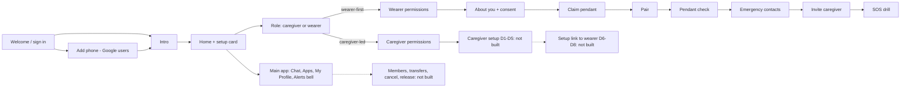

# 2. Features: status and known limits

**Status key.** **Done**: built in the app, nothing the frontend still owes. **Partial**: usable, with named gaps. **Next version**: not built in the app
(it may already exist on the backend: the table says so).

**Backend column.** What the backend offers, from the endpoint list in [`docs/openapi.json`](../openapi.json) (80 paths, the live spec) and the
backend repo (`svaraa-backend`, read on 24 Nov 2026). "Checked" means someone tried the endpoint on the Render dev server directly (from
[`integration.md`](../integration.md)); **nothing has been tried end to end from a phone**. Everything in the app still defaults to mocks (`config/flags.ts`).

Items marked **(?)** could not be settled from the backend code (usually: what is deployed on Render, or a decision still to be made). They are to be confirmed with the backend team.

> Reviewed against code, `integration.md`, `open-items.md` and the backend repo on branch `docs/FE-34-development-guide`. Not QA-tested on devices.
> The team should still confirm the Status column.

## What changed in this review

- Pulled `core`: nothing new. All `core` feature branches are already in this branch; `vjk-changes` is an older umbrella of the same work.
- **The backend is ahead of the app.** Setup links, members, transfers, step-up OTP, cancel/release, disputes and more exist on the server but have **no screens
  yet** (see "Built on the backend, not in the app" below).
- **`services/api/pending.ts` is now empty** (`PendingPaths = Record<never, never>`): every household, claim, pairing, contacts, invite and drill endpoint the
  app needed is now in `openapi.json`. The "Pending backend" tables in `open-items.md` are out of date for those rows.
- The backend's **voice socket (merged in `origin/main`, PRs #24 and #25) accepts a sign-in token and `conversation_id`**, and sends `reply_start` / `reply_end` frames and PCM audio on request. The app's
  voice code still assumes none of that (see Voice).
- The backend's text to speech is **edge-tts** (requirements list `edge-tts`, no ElevenLabs code), not ElevenLabs as `.env.example` suggests.
- Backend PR #25 ("Fix/voice and music") is **merged**. The backend's `chat` needs sign-in. It has no cookies, no `is_owner`, no YouTube code and no playlists.
- **Real claim codes do not fit the app.** The backend's box codes look like `SVRD-K7F2-QX9M-3HTC-V8WD-N4PA` (prefix + 5 groups of 4, no 0, 1, I, L, O, U). `features/wearer/claimCode.ts` accepts exactly 12 characters (`SVRA-2041-7K3P`), so it rejects real codes. Only the `MOCK-...` test codes pass. **Fix before real pendants.**
- **`POST /devices/{id}/pairing/complete` records the three C4 checks** (touch, speaker, mic). The app never calls it (the backend answers `checks_incomplete` / `device_not_verified` around it).
- The backend has about **120 error codes**; the app lists about 50. Of the 6 codes the app invented, `invalid_claim_code`, `invalid_device_signature` and `invite_role_invalid` **do not exist** on the server. Spotify's real codes (`spotify_not_connected`, `spotify_premium_required`, `spotify_no_device`, `spotify_reconnect_required`, `spotify_disabled`) are missing in `errors.ts`.
- The server **does not accept health notes or pacemaker** (`CircleCreateIn` / `CirclePatchIn` have no such fields); the app keeps them on the phone only.
- The backend is building **reminder responses** (done / pending per occurrence; an uncommitted migration `0015_reminder_occurrences`). The app keeps those answers on the device only.

## Product flow

## Account and setup

| Feature                                     | Status       | Backend                                                                                                            | Known limits                                                                                                                                                                                                                                                                                                                                        |
| ------------------------------------------- | ------------ | ------------------------------------------------------------------------------------------------------------------ | --------------------------------------------------------------------------------------------------------------------------------------------------------------------------------------------------------------------------------------------------------------------------------------------------------------------------------------------------- |
| Sign in with phone OTP (A1, A2)             | Done         | Live on web. SMS code exists (`OTP_PROVIDER=textbee`); dev uses fixed `0000`                                       | Whether Render sends real SMS (?). Web tokens are kept in `localStorage` (readable by any script on the page): review before production                                                                                                                                                                                                             |
| Sign in with Google                         | Partial      | Endpoint exists (`/auth/google`)                                                                                   | Web works with a web client ID. Phones need a development build + OAuth clients; not tried with real accounts                                                                                                                                                                                                                                       |
| Add your phone (A2)                         | Partial      | `/auth/mobile/request`, `/verify`                                                                                  | `/users/me` has no mobile number or "verified" flag (?): the number is remembered on the phone, so a new phone asks again                                                                                                                                                                                                                           |
| Intro (A3)                                  | Partial      | n/a                                                                                                                | Placeholder illustrations; Hindi is a first draft                                                                                                                                                                                                                                                                                                   |
| Home + setup card (A4)                      | Done         | Checked (`/me/home`)                                                                                               | Home resumes setup from the server. No name step for phone users ("Hello"). Terms and Privacy are plain text, not links (**needed before store release**)                                                                                                                                                                                           |
| Role choice (B1)                            | Done         | Checked                                                                                                            | Nothing saved at B1; the server creates the household at C1                                                                                                                                                                                                                                                                                         |
| Caregiver permission (B3)                   | Done         | `/me/installations`                                                                                                | A placeholder token is saved on mocks; the real push token needs an EAS project id + device build. The backend has **no push sender in v0** (?)                                                                                                                                                                                                     |
| Wearer permissions (B2)                     | Partial      | `/me/installations`                                                                                                | Bluetooth shown as allowed (simulator). "Always" location cannot be tested in Expo Go. Android battery exemption only opens settings                                                                                                                                                                                                                |
| About you + consent (C1)                    | Partial      | Checked (`POST /circles`, consent)                                                                                 | App sends consent version `2026-11-v1` (matches the backend). The server holds the consent text (`core/consent.py`) but returns it only in the setup-link preview, so wearer-first uses the app's own text, a first draft that needs legal review. Health notes and pacemaker are kept on the phone only                                            |
| Claim pendant (C2)                          | Partial      | Checked (`POST /devices/claim`)                                                                                    | **Real codes are `SVRD-` + 5 groups of 4; the app accepts only 12 characters** (`features/wearer/claimCode.ts`), so only `MOCK-...` test codes work today. The QR link format (`https://svaraa.ai/c/<code>`) is a guess (?). "Already claimed" screen (E5), "ask the owner" not built. The backend now has **no owner**, only roles (see Questions) |
| Pair + pendant check (C3, C4)               | Partial      | Checked (`pairing/challenge`, `verify`). `pairing/complete` records the 3 checks; **the app does not call it**     | Pendant is the in-app **simulator**. Server expects an Ed25519 signature (base64url) of the raw nonce; units without a key are "press only". The simulator uses a `sim:` fake                                                                                                                                                                       |
| Emergency contacts (C5, C6)                 | Done         | Checked (list, add, delete). Edit (`PATCH`) is ready on the server                                                 | The app edits by deleting and re-adding; it does not call `PATCH`. Limit of 5 in My Profile is a guess                                                                                                                                                                                                                                              |
| Invite a caregiver (C7)                     | Partial      | Checked (`POST /member-invites`). List, revoke, `redeem` exist                                                     | The app only **creates** the invite code. Joining with a code, pending state, approve/reject, revoke are not built                                                                                                                                                                                                                                  |
| SOS drill (C8)                              | Partial      | Checked (start, get, `ack`). `cancel` exists                                                                       | App polls every 2 s; no cancel button. **The drill service sends no SMS, call or push** (none found in the backend), so contacts are not alerted by the server today (?: planned). Calls only open the dialer (`tel:`); no automatic calling or 112; no real SOS screen                                                                             |
| Caregiver-led setup D1-D5                   | Next version | Backend ready (`caretaker_led` circles, `setup-link`, drafts)                                                      | `/setup` is a test screen                                                                                                                                                                                                                                                                                                                           |
| Setup link, deep links, web landing (D6-D8) | Next version | Backend ready (`/setup-invites/lookup`, `preview`, `draft`, `consent`, `decline`, `reject`, `/me/pending-invites`) | No `svaraa.ai/j/<token>` page; app links (AASA, assetlinks) not set up (?)                                                                                                                                                                                                                                                                          |

### Built on the backend, not in the app (frontend to do)

| Feature (screens E3-E5 and settings)                | Backend endpoints                                                                                             | Notes                                                                                  |
| --------------------------------------------------- | ------------------------------------------------------------------------------------------------------------- | -------------------------------------------------------------------------------------- |
| Members: list, change role, approve, reject, remove | `GET /circles/{id}/members`, `PATCH .../members/{uid}`, `/approve`, `/reject`, `/remove`                      | Remove needs a step-up code (see next row). My Profile has no caregivers/members list  |
| Step-up code ("Confirm with OTP")                   | `POST /me/step-up`                                                                                            | One shared confirm step is needed for removals, promotions, transfers, release, cancel |
| Transfer caregiver role                             | `POST /circles/{id}/caretaker-transfers`, `GET /me/transfers`, `POST /transfers/{id}/accept\|decline\|cancel` | 24 h to accept                                                                         |
| Transfer wearer (new person)                        | `POST /circles/{id}/wearer-transfers`                                                                         | Returns a setup link; pendant goes back to unverified                                  |
| Cancel household                                    | `POST /circles/{id}/cancel`                                                                                   | Needs step-up code                                                                     |
| Release pendant, dispute a pendant                  | `POST /devices/{id}/release`, `POST /devices/disputes`                                                        | The "second-hand / already claimed" path (E5)                                          |
| Withdraw consent                                    | `POST /circles/{id}/consent/withdraw`                                                                         |                                                                                        |
| List pendants of a household                        | `GET /circles/{id}/devices`                                                                                   | Pendant ownership and transfer in My Profile                                           |

## Main app

| Feature                                                  | Status       | Backend                                                                                                                                                                                | Known limits                                                                                                                                                                                                                                                                          |
| -------------------------------------------------------- | ------------ | -------------------------------------------------------------------------------------------------------------------------------------------------------------------------------------- | ------------------------------------------------------------------------------------------------------------------------------------------------------------------------------------------------------------------------------------------------------------------------------------- |
| Chat (text)                                              | Partial      | `POST /chat/` contract from Render; `/chat/stream` exists, unused                                                                                                                      | Not tried through the app. Chat **needs sign-in** (confirmed in the backend). Proposed actions are mock. Streaming replies not used                                                                                                                                                   |
| Chat history + sidebar/drawer                            | Partial      | `GET/PATCH/DELETE /conversations...`                                                                                                                                                   | Older messages (`older_cursor`) and more than 50 chats are not loaded; rename/delete exist in the service but not in the UI. Search icon only opens All chats                                                                                                                         |
| Voice: dictation mic (web)                               | Done (web)   | None (browser speech to text)                                                                                                                                                          | Web only                                                                                                                                                                                                                                                                              |
| Voice: Talk call screen                                  | Partial      | `WS /api/v1/voice/ws` (backend code accepts `Authorization: Bearer` or `?token=`, `conversation_id`, `reply_format=pcm16`, `reply_start` / `reply_end` frames; turns saved to history) | **Browser only** uses the socket, and its code still assumes no token, no `reply_end` and Hindi speech only. Phones and tests play a scripted demo. Merged in the backend's `main`; whether Render runs it (?). Text to speech is edge-tts; speech recognition is hard-coded to Hindi |
| Apps tab + Manage apps                                   | Done         | None (choices stored on this phone)                                                                                                                                                    | Not per wearer, so the pendant does not follow them. Riddles switch has no app. Quiet hours (default 22:00-06:00) not enforced by anything                                                                                                                                            |
| My Profile + Edit profile                                | Partial      | Wearer and contacts via household endpoints                                                                                                                                            | Missing: reorder contacts, caregivers/members, pendant transfer, notification settings, consent record, delete account, help, app version                                                                                                                                             |
| Settings: language, display size, theme, home background | Partial      | Local                                                                                                                                                                                  | Language and display size are saved; **light/dark and home background reset on restart**. 6 languages: `en`, `hi` full; `ta`, `zh`, `ko`, `ja` first drafts                                                                                                                           |
| Alerts (bell) and Explore                                | Next version | n/a                                                                                                                                                                                    | Placeholders; new-alert dot not built                                                                                                                                                                                                                                                 |
| Pendant status (pill + Pendant app)                      | Partial      | Simulator                                                                                                                                                                              | "Listening" always Off; no background mode, wearer push or "seen N min ago" (FE-16)                                                                                                                                                                                                   |
| Contacts app (in Apps)                                   | Done         | Household contacts                                                                                                                                                                     | Same limits as Emergency contacts                                                                                                                                                                                                                                                     |
| Web layout (wide, 900 dp and up)                         | Partial      | n/a                                                                                                                                                                                    | Chat pane beside apps is draggable; no keyboard resize or double-click snap. Web = caregiver screens only                                                                                                                                                                             |

## Apps

| App                          | Status          | Backend                                                                      | Known limits                                                                                                                                                                                                                                                                                                             |
| ---------------------------- | --------------- | ---------------------------------------------------------------------------- | ------------------------------------------------------------------------------------------------------------------------------------------------------------------------------------------------------------------------------------------------------------------------------------------------------------------------ |
| News (`flags.news`: on)      | Partial         | `GET /news`, `/news/filters` exist                                           | Feed snippets, not an AI summary; categories and languages, not "top five by region". `docs/task-news-ai-search.md` describes an older design (`/news/{region}`) and is **out of date**                                                                                                                                  |
| Notes (`flags.notes`: on)    | Partial         | `/notes` exists; uploads returned `503 notes_unavailable` on Render (20 Nov) | Storage not configured then (?). Full flow checked only on mock. Recording stops when backgrounded; no voice start from pendant; action items not turned into reminders                                                                                                                                                  |
| Reminders                    | Partial         | Server checked; **backend is adding reminder responses** (not merged)        | No ringing on phones; web alerts only while the page is open. Answers (Done / Pending / Discuss / Dismiss) are device-only until the backend ships them. "Speak aloud", "Repeat until done", "Tell admins" switches do nothing; every-2-hours reminders not built; uses phone time zone. **`flags.reminders` is unused** |
| Music                        | Partial         | `/music/tracks` checked                                                      | Plays on the phone, not the pendant; no background playback until the `expo-audio` plugin option + new build; no server playlists. **`flags.music` is unused**                                                                                                                                                           |
| Spotify (Music tab)          | Partial         | `/spotify/*` contract from Render                                            | Not tried with a real account. The server's real Spotify codes (`spotify_not_connected`, `spotify_premium_required`, `spotify_no_device`, `spotify_reconnect_required`, `spotify_disabled`) are **not in the app's error list**. No range picker on `top`. Needs `spotifyApi` real                                       |
| YouTube (Music tab)          | Partial         | None (curated embeds)                                                        | Search, account link and pendant are design-only (the backend repo has no YouTube code or design doc)                                                                                                                                                                                                                    |
| One player at a time (FE-33) | Done (frontend) | Backend PR #25 is merged                                                     | Chat events and voice frames covered by unit tests / mocks only                                                                                                                                                                                                                                                          |
| Games (3)                    | Done            | None                                                                         | Best scores kept only while the app is open. Layouts checked in a browser only; sounds on phones untried (needs rebuilt dev build)                                                                                                                                                                                       |
| Responses                    | Partial         | Chat history                                                                 | Quick replies are sample content                                                                                                                                                                                                                                                                                         |

## Platform

| Area                                   | Status       | Known limits                                                                               |
| -------------------------------------- | ------------ | ------------------------------------------------------------------------------------------ |
| Pendant connection layer               | Partial      | One interface; `SimulatorTransport` only. Real Bluetooth (`react-native-ble-plx`) not done |
| Background mode, background audio test | Next version | Needs `react-native-audio-api` and a development build                                     |
| Real push (phone and web)              | Next version | No push sender found in the backend repo (v0); app saves a token only                      |
| EAS builds + store release             | Next version | See [Deployment](04-deployment.md): no EAS project id, no production profile               |
| Automated end-to-end tests (Maestro)   | Next version | 40 Jest files; no device or browser tests                                                  |
| Error reporting (Sentry)               | Next version | Planned in the stack; not installed. The backend sends metrics to Grafana Cloud            |

> **Feature flags.** Only `flags.news` and `flags.notes` hide or show an app tile (`features/apps/AppViews.tsx`). `flags.music` and `flags.reminders` are
> declared `false` but **nothing reads them**: Music and Reminders always show (users can hide them in Manage apps). Wire them or delete them.

## Documents that are out of date

| File                                          | Problem                                                                                                                                               |
| --------------------------------------------- | ----------------------------------------------------------------------------------------------------------------------------------------------------- |
| `docs/open-items.md`, "Pending backend" table | Lists household, claim, pairing, contacts, invites, drill and push-token endpoints as "not in openapi.json"; they are now (and `pending.ts` is empty) |
| `docs/backend-integration-handoff.md`         | Says the spec has 9 paths and lists steps already done; now 80 paths                                                                                  |
| `docs/task-news-ai-search.md`                 | Designs `GET /news/{region}`; the real endpoint is `GET /news` with categories                                                                        |
| `docs/open-items.md`                          | Consent version says `2026-11-v0`; the code sends `2026-11-v1`                                                                                        |
| `CLAUDE.md`                                   | Names backend branch `feature/auth-and-user-creation`; the spec is now the live one                                                                   |

## How to keep this page honest

When a PR finishes, postpones or completes something, update its row here **and** the matching row in `open-items.md` / `integration.md`. The PR template's
"Mocked / pending backend" box is the prompt.
