# 3. Extending guide: add a feature without conflicts

Follow this recipe and two developers can work in parallel without touching the same files. The golden rule: **a feature adds files; it
edits shared files in a few small, known places.**

## Where things go

```mermaid
flowchart LR
  subgraph New["Files you ADD"]
    N1["app/your-screen.tsx"]
    N2["features/your-feature/*"]
    N3["services/your-area/yourApi.ts"]
    N4["services/mocks/yourArea.ts"]
    N5["__tests__/your-feature.test.tsx"]
  end
  subgraph Shared["Shared files: tiny edits, each in its own PR if possible"]
    S1["config/flags.ts - one switch"]
    S2["services/mocks/routes.ts - register mock routes"]
    S3["i18n/en.json + hi.json - your keys only"]
    S4["features/apps/AppViews.tsx + apps.name.* - if it is an app tile"]
    S5["app/_layout.tsx - if it is a new route"]
    S6["docs: integration.md, open-items.md, 02-features.md"]
  end
  New --> Shared
```



Shared design-system folders (`ui/`, `config/`) change in **small, separate PRs** (frontend plan rule), not inside a feature PR.

## Recipe

### 0. Ticket and branch

```bash
git switch main && git pull
git switch -c feat/FE-34-your-feature     # type/FE-XX-short-name; the ticket ID is required
```

Rebase on `main` every morning (`git pull --rebase origin main`). One PR per ticket, under about 400 lines, reviewed by the other developer.

### 1. API contract first

1. Is the endpoint in `docs/openapi.json`? If yes, run `npm run api:generate` after any update to the file. Commit only the regenerated
   `services/api/schema.d.ts` with the new `openapi.json`, ideally in its own commit.
2. If not, it is **pending backend**: add its types to `services/api/pending.ts` (same shape as `schema.d.ts`) and list it in the
   "Pending backend" table of `docs/open-items.md`.

### 2. Service (all outside calls live here)

Create `services/<area>/<area>Api.ts` using `api` and `call` from `@/services/api`. Return plain app types; map server codes in
`services/api/errors.ts` (real lowercase codes, e.g. `invalid_otp`) and show **our own i18n text**, never server text. Screens and
features never `fetch` directly.

### 3. Mock (so the screen works with no server)

Add `services/mocks/<area>.ts` for sample data and register routes in `services/mocks/routes.ts`. Mark each mocked endpoint
`// PENDING BACKEND`. State that must survive a reload goes in `services/storage` or `secureStorage`, not module variables (`mocks/db.ts`
is in memory and resets on reload).

### 4. Flag (one switch per area)

In `config/flags.ts`: add the area to the `Flags` type, to `flags` as `source('<area>', 'mock')`, and to `areaOf()` so its paths map to the
area. Default is always `'mock'`. If the feature is an app tile that can be turned off, also add a boolean (the way `news` and `notes` are)
and filter it in `features/apps/AppViews.tsx`.

### 5. Feature code and screen

- Logic, stores (Zustand) and hooks: `features/<name>/`. Server state: TanStack Query. App state: Zustand.
- Screen: `app/<route>.tsx`, thin, composing `features/` and `ui/`. If it is a new route, register it in the right guard group in
  `app/_layout.tsx` (`Stack.Protected` for signed-in screens).
- Phone-only code: `<file>.native.ts` **and** a `<file>.web.ts` stub (see `services/secureStorage.*`, `services/voice/dictation*.ts`).
- New app tile: add the id to `AppId` and `ORDER` in `features/apps/AppViews.tsx`, its view in the map, an icon in `AppsScreen.tsx`,
  and `apps.name.<id>` in both i18n files.
- Use only `ui/` components and theme tokens ([UI guide](../ui-guide/README.md)).

### 6. Text in both languages

Add keys to **`i18n/en.json` and `i18n/hi.json`** (`ta`, `zh`, `ko`, `ja` are optional drafts). Use `t('your.key')`. Put your keys under a
namespace for your feature and append in one block, so merges do not collide. `npm run i18n:check` fails on missing Hindi keys,
placeholder mismatches and hard-coded JSX text.

### 7. Tests

Add `__tests__/<feature>.test.ts(x)`. Use `test-utils/render.tsx` (providers) and `test-utils/backend.ts`. Tests run on mocks only.

### 8. Docs

- `docs/integration.md`: add or update the status row (area, endpoint, service file, switch, status).
- `docs/open-items.md`: anything postponed or pending backend.
- `docs/development/02-features.md`: the feature row and its known limits.

### 9. Check, commit, PR

```bash
npm run check && npm run format:check
git commit -m "feat(FE-34): add your feature"      # hooks check the message
git push -u origin feat/FE-34-your-feature
```

Open the PR from `.github/pull_request_template.md` (EN + HI screenshots, "Mocked / pending backend"). CI must be green.

## Hot spots: avoid or coordinate

Files many people touch. Keep edits small, additive and at the end of the relevant block, and merge them early:

| File                                | Why it conflicts          | Tip                                                                        |
| ----------------------------------- | ------------------------- | -------------------------------------------------------------------------- |
| `services/mocks/routes.ts` (large)  | Everyone registers routes | Put logic in `services/mocks/<area>.ts`; one entry here                    |
| `i18n/en.json`, `i18n/hi.json`      | Everyone adds keys        | Own namespace; do not reformat or reorder others' keys                     |
| `config/flags.ts`                   | New area switches         | Add three lines (type, value, `areaOf`)                                    |
| `app/_layout.tsx`                   | New routes                | One `Stack.Screen` line in the correct guard                               |
| `docs/openapi.json`, `schema.d.ts`  | Regenerated file          | Separate PR; never hand-edit `schema.d.ts`                                 |
| `package.json`, `package-lock.json` | Dependencies              | Add with `npx expo install <pkg>`; separate PR if it needs a new dev build |
| `ui/`, `config/env.ts`              | Design system / env       | Small separate PR                                                          |

## Rules checklist (copy into your PR)

- [ ] Screens (`app/`) make no API, Bluetooth, WebSocket or storage calls
- [ ] No hard-coded text; `en` and `hi` both updated; `npm run i18n:check` passes
- [ ] "caregiver" and "household" wording (never "caretaker" or "circle" outside `services/household/`)
- [ ] Colours from tokens; buttons and tap targets the same in caregiver and wearer themes
- [ ] Mocked endpoints marked `// PENDING BACKEND`; area flag defaults to `'mock'`
- [ ] Native-only code has a `.web.ts` stub
- [ ] Docs updated (`integration.md`, `open-items.md`, features page)

## For AI tools

[`CLAUDE.md`](../../CLAUDE.md) holds the rules for AI assistants. [`AGENTS.md`](../../AGENTS.md) is Expo's generic template and mentions
`src/app/`; **this repo uses `app/` at the root**, so follow `CLAUDE.md` where they differ. Expo changes every SDK: check the docs for
the installed `expo` version (58) before using any Expo API.
