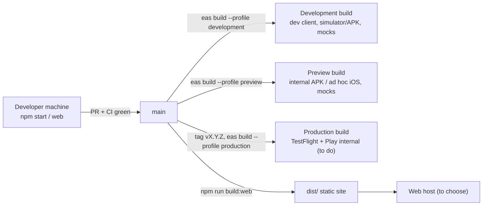
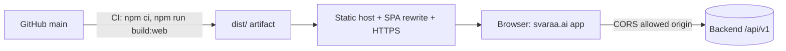

# 4. Deployment: EAS builds and web hosting

## What exists today and what does not

| Item        | State                                                                                                      |
| ----------- | ---------------------------------------------------------------------------------------------------------- |
| `eas.json`  | Profiles `development` and `preview` only. **No `production` profile, no `submit` config**                 |
| EAS project | **Not created or linked**: no `extra.eas.projectId` in `app.json`; no builds run yet (see `open-items.md`) |
| App IDs     | iOS bundle `ai.svaraa`, Android package `ai.svaraa`, URL scheme `svaraa`                                   |
| Web export  | Works: `npm run build:web` → `dist/` (single-page app). CI runs it on every PR                             |
| Web host    | **Not chosen**, no deploy workflow, no hosting config                                                      |
| CI          | `.github/workflows/ci.yml`: lint, format, typecheck, tests, i18n, web build (Node 22)                      |

Items marked "to do" below are steps that still have to happen once; they are not yet in the repo.

## Environments and versions



`eas.json` uses `"appVersionSource": "remote"`: EAS owns the build number and increments it; you set the user-facing `version` in
`app.json`. Tag releases in git (`v1.0.0`) so this documentation and the code travel together.

## Environment variables in builds

`.env` is **not uploaded to EAS**. `EXPO_PUBLIC_*` values for a build must be in the profile's `env` block in `eas.json` or in EAS
environment variables on expo.dev (`eas env:create`). They are public: never put a secret in them.

Current profiles set only `EXPO_PUBLIC_USE_MOCKS=true`, so **today's builds talk to the mock backend**. For a build against the real
server set at least:

```jsonc
// eas.json: example for a real-backend profile (add; do not commit secrets)
"staging": {
  "distribution": "internal",
  "android": { "buildType": "apk" },
  "env": {
    "EXPO_PUBLIC_APP_ENV": "staging",
    "EXPO_PUBLIC_API_URL": "https://<backend host, no /api/v1>",
    "EXPO_PUBLIC_USE_MOCKS": "false",
    "EXPO_PUBLIC_GOOGLE_WEB_CLIENT_ID": "<id>.apps.googleusercontent.com",
    "EXPO_PUBLIC_GOOGLE_IOS_CLIENT_ID": "<id>.apps.googleusercontent.com",
    "EXPO_PUBLIC_SHOW_DEV_OTP_HINT": "false"
  }
}
```

Caution: `USE_MOCKS=false` sends **every** call to the server, including endpoints it does not have yet (the "Pending backend" list in
`open-items.md`). Until those exist, use `USE_MOCKS=true` with `EXPO_PUBLIC_REAL_AREAS` listing the areas that are real. Note that
`config/flags.ts` reads `EXPO_PUBLIC_REAL_AREAS` at build time, so it works in an EAS `env` block too.

`app.config.ts` turns `EXPO_PUBLIC_GOOGLE_IOS_CLIENT_ID` into the iOS URL scheme at build time, so the iOS value **must** be present in the EAS
environment or Google sign-in will not return to the app.

## One-time EAS setup (to do)

```bash
npx eas-cli@latest login            # Expo account
npx eas-cli@latest init             # creates the project, writes extra.eas.projectId into app.json: commit it
npx eas-cli@latest credentials      # or let the first build create iOS/Android signing credentials
```

Then:

1. Add a `production` profile (store distribution, `autoIncrement` not needed with remote versioning) and a `submit` section.
2. Apple: Apple Developer account, App Store Connect app with bundle id `ai.svaraa`; Google Play: app with package `ai.svaraa`.
3. Google sign-in on Android needs an OAuth client for `ai.svaraa` **plus the SHA-1 of each signing key** (the EAS keystore, and Play's
   app-signing key after upload). Get the EAS one with `eas credentials`.
4. The real push token needs the project id from step 1 and a device build.
5. Review the privacy strings in `app.json` (Bluetooth, camera, location "always", microphone): the stores read them.
6. Terms and Privacy Policy links and legal review of the consent text are required **before store release** (`open-items.md`).

## Building

```bash
# development client (needed for Google sign-in on phones, real push, native modules)
npx eas-cli@latest build --profile development --platform ios      # iOS simulator build
npx eas-cli@latest build --profile development --platform android  # APK
npm run start:dev                                                   # then open the dev client

# preview: internal testers
npx eas-cli@latest build --profile preview --platform all

# production (after the profile exists)
npx eas-cli@latest build --profile production --platform all
npx eas-cli@latest submit --platform all
```

Install on a phone: open the build's page on expo.dev and scan the QR code (Android APK). Real iPhones need ad hoc provisioning
(`eas device:create`) or TestFlight. Add a development build again whenever you add a library with native code
(for example `expo-audio` options, `react-native-ble-plx`).

Rebuild is required when native config changes (`app.json` plugins, permissions, `app.config.ts`). JavaScript-only changes can later be
shipped with `eas update` (needs `expo-updates` and a channel; **not set up**).

## Release routine (proposed, from the frontend plan)

Friday 4 pm: merge stops; an EAS preview build goes to demo phones; Saturday demo on real phones. Milestone M4 target is TestFlight +
Play internal builds. Per release:

1. `npm run check && npm run format:check && npm run build:web` pass on `main`.
2. Bump `version` in `app.json`; update `02-features.md` and `open-items.md`.
3. `git tag vX.Y.Z && git push origin vX.Y.Z`.
4. Build and submit; smoke-test sign-in, setup, chat, SOS drill on a real phone.

## Web hosting

The web build is a static single-page app (`app.json` → `web.output: "single"`), so any static host works. Build:

```bash
EXPO_PUBLIC_API_URL=https://<backend> EXPO_PUBLIC_USE_MOCKS=false npm run build:web   # output in dist/
```

Environment values are baked in at export time. Without `USE_MOCKS=false`, the site starts the MSW mock service worker
(`dist/mockServiceWorker.js`), which is right for a demo and wrong for production.

Hosting requirements, whichever host you pick:

- **SPA fallback:** rewrite every unknown path to `/index.html` (deep links like `/home` and the planned `/j/<token>` setup link must
  work on refresh).
- **HTTPS**, required for the microphone, camera and browser notifications.
- **Backend CORS:** the backend's `CORS_ORIGINS` must include the site's exact origin. The dev server currently allows `http://localhost:5173`.
- Google sign-in: add the site origin to the web client's "Authorized JavaScript origins".
- Setup link host: `svaraa.ai` is expected to serve `/j/<token>` and `/c/<code>`; the web landing for these (D6-D8) is **not built**.



Options (**a decision for the team, none is set up**): Expo's own hosting (`npx eas-cli@latest deploy`, EAS Hosting), Netlify, Vercel,
Cloudflare Pages, or S3 + CloudFront. Pick one, add its SPA-rewrite file, and add a deploy job after the existing CI checks. Update this
page when you do.

## Common failures

| Symptom                                  | Cause / fix                                                                                            |
| ---------------------------------------- | ------------------------------------------------------------------------------------------------------ |
| Build talks to mocks                     | Profile `env` still has `EXPO_PUBLIC_USE_MOCKS=true`, or `.env` was assumed to be uploaded             |
| Google sign-in fails on a phone build    | Missing iOS client id in the EAS env; Android SHA-1 not added to the OAuth client; building in Expo Go |
| No push token                            | No EAS project id in `app.json`, or running in Expo Go                                                 |
| Web refresh on a deep link is a 404      | Host lacks the SPA rewrite to `/index.html`                                                            |
| Web calls blocked in the browser console | Backend `CORS_ORIGINS` lacks this origin                                                               |
| `npm ci` peer dependency errors          | Keep `.npmrc` (`legacy-peer-deps=true`)                                                                |
