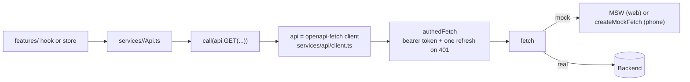
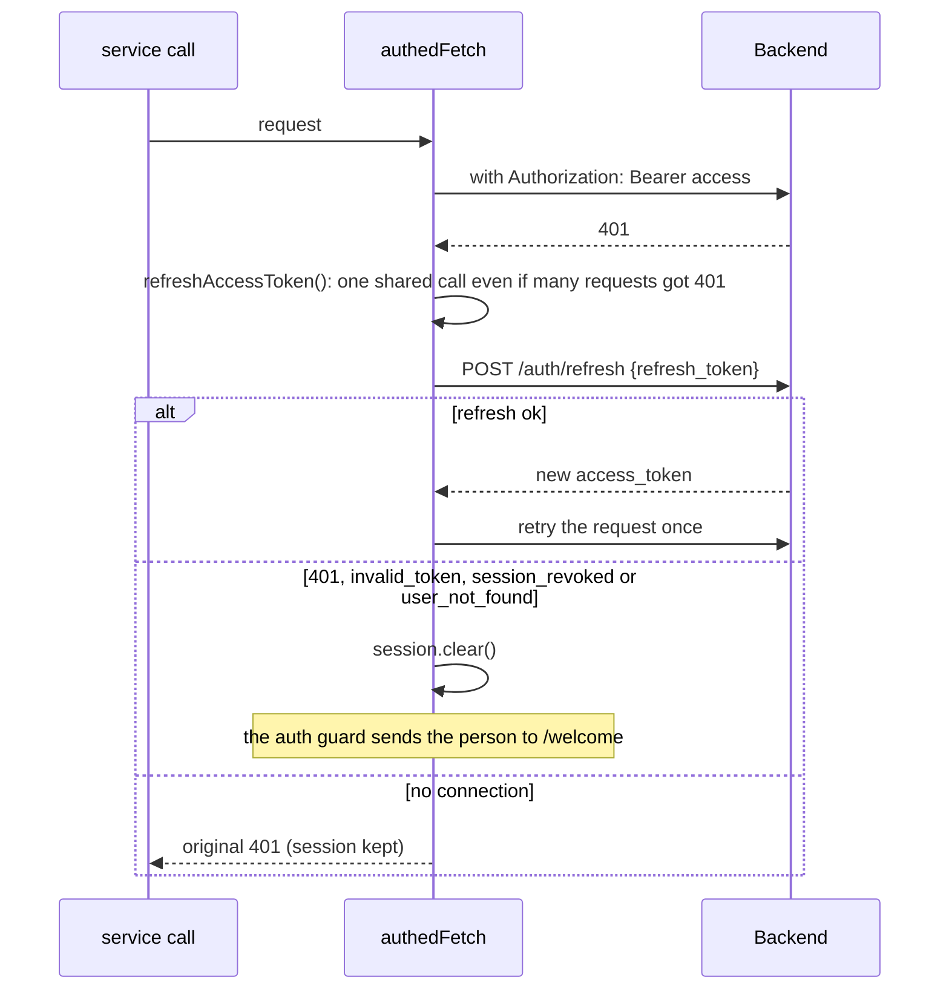
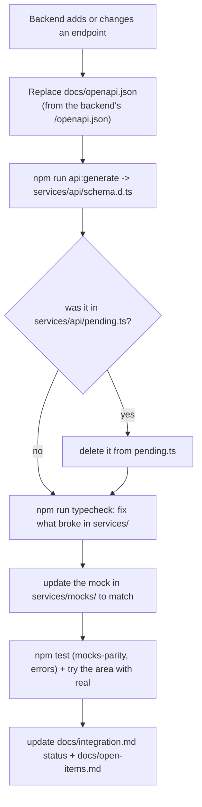

# 5. Backend integration guide

How the app talks to the backend, how errors and sign-in sessions work, how mocks are written, and what to do when the contract changes.
Per-endpoint status lives in [`integration.md`](../integration.md); this page explains the machinery. Contract: [`docs/openapi.json`](../openapi.json).

## The layers



- `api` is typed from `docs/openapi.json` plus hand-written `PendingPaths` (`services/api/pending.ts`).
- `call(request)` awaits it and returns the data, or **throws an `ApiError`** (never a raw response).
- Screens and features never call `api` or `fetch` themselves (ESLint blocks `openapi-fetch` in `app/`). They call a function from `services/`.
- The base URL is `env.apiUrl` (no `/api/v1`: the generated paths include it).

## Sign-in session and token refresh

`services/auth/session.ts` (Zustand) holds `accessToken`, `refreshToken`, `userId`, sign-in `method` and the saved phone number. It is saved under
`svaraa.session` in secure storage (SecureStore on phones, `localStorage` on web) and restored at app start.



Public paths (`/auth/otp/request`, `/auth/otp/verify`, `/auth/google`, `/auth/refresh`) carry no token and are never retried.
Access tokens live 3 days and refresh tokens about 5 years (backend defaults), so a 401 is rare in practice.

## Errors

The backend sends `{ "error": { "code": "invalid_otp", "message": "..." } }` with **lowercase codes**. `toApiError()` turns anything (error body,
thrown `TypeError` for no network, bare status) into an `ApiError` with `code`, `status` and extra safe `details` (for example `owner_hint`).

Rules:

1. **Never show server text.** Show our own i18n text: `t(errorMessageKey(error.code))` → `errors.<code>` in `en.json` and `hi.json`.
2. A code the app does not know falls back to its HTTP status (401 `unauthorized`, 403 `forbidden`, 404 `not_found`, 409 `conflict`,
   422 `validation_error`, 429 `rate_limited`, 503 `service_unavailable`, 5xx `internal_error`) or `unknown`. `features/auth/useErrorText.ts` is the hook for screens.
3. **A new code needs three edits:** add it to `CODE_TABLE` in `services/api/errors.ts`, add `errors.<code>` in English and Hindi, and (if it ends the
   sign-in) add it to `SESSION_ENDED_CODES`. `__tests__/errors.test.ts` fails when text is missing.

Code groups in `CODE_TABLE`:

| Group        | Codes (examples)                                                                                                                                           |
| ------------ | ---------------------------------------------------------------------------------------------------------------------------------------------------------- |
| Sign-in      | `invalid_otp`, `otp_cooldown`, `rate_limited`, `invalid_mobile_number`, `invalid_google_token`, `mobile_number_taken`                                      |
| Session      | `missing_token`, `invalid_token`, `session_revoked`, `user_not_found`                                                                                      |
| Household    | `circle_not_found`, `invalid_circle_state`, `insufficient_role`, `consent_required`                                                                        |
| Pendant      | `invalid_claim_code`, `device_already_claimed` (+ `owner_hint`), `invalid_device_signature`, `drill_not_found`, `drill_not_running`, `invite_role_invalid` |
| Reminders    | `reminder_too_soon`, `reminder_too_far_ahead`, `reminder_limit_reached`, `invalid_reminder_rule`, `invalid_timezone`                                       |
| Notes        | `notes_unavailable`, `notes_daily_limit_reached`, `recording_too_long`, `note_not_found`, `note_audio_gone`                                                |
| Spotify      | `spotify_error`, `spotify_playlist_not_listable`                                                                                                           |
| Generic      | `validation_error`, `bad_request`, `unauthorized`, `forbidden`, `not_found`, `conflict`, `service_unavailable`, `internal_error`                           |
| Added by app | `network_error`, `google_sign_in_unavailable`, `google_sign_in_failed`, `pendant_not_found`, `pendant_connect_failed`, `pendant_not_connected`, `unknown`  |

Some codes (`invalid_claim_code`, `device_already_claimed`, `invalid_device_signature`, `drill_*`, `invite_role_invalid`) are the **frontend's
proposal** and are marked pending in the code. Confirm them with the backend team.

## Household versus circle

The product word is **household**; the backend's word is **circle**. Only the service and store layer translates:

| App / UI word      | Backend                                                | Where translated                                     |
| ------------------ | ------------------------------------------------------ | ---------------------------------------------------- |
| household          | `circle`, `/circles`, `/circles/{id}/...`, `circle_id` | `services/household/`, `features/household/store.ts` |
| caregiver (admin)  | roles `admin`, `viewer`, plus an `owner` flag          | `services/household/`                                |
| wearer             | role `wearer`                                          | same                                                 |
| claim pendant      | `POST /devices/claim`                                  | `services/household/wearerApi.ts`                    |
| invite a caregiver | `POST /circles/{id}/member-invites`                    | same                                                 |

Do not introduce "circle" in screens, i18n or docs. `DRAFT_HOUSEHOLD_ID` is a placeholder id used before the server creates the household at C1.

## Request conventions

- **Time zone:** reminders and chat send `X-Timezone` (the phone's zone). Unknown names get `400 invalid_timezone`.
- **Paging:** cursor based (`cursor` in, `next_cursor` out; conversations also have `older_cursor`). News, notes, Spotify browse lists.
- **Timeout:** `EXPO_PUBLIC_API_TIMEOUT_MS` (60 s) because Render's free tier sleeps.
- **Uploads:** notes use `multipart/form-data` (`audio`, `duration_seconds`, `recorded_at`, `title`).
- **Chat events:** a chat reply can carry `events` (`music`, `spotify`, `settings`, `profile`, `contacts`). `services/chat/applyChatEvents.ts` applies them
  to the UI. New event kinds are added there.
- **Voice socket:** see [Pendant and voice](08-pendant-and-voice.md).

## When the contract changes



- Commit `openapi.json` and the regenerated `schema.d.ts` together, in a PR of their own. Never hand-edit `schema.d.ts`.
- Fixes go in `services/` and mocks, not in screens (a rule from `CLAUDE.md`). If a screen has to change, the app's own type in `services/` was wrong.
- The source of the file is the backend repo (`feature/auth-and-user-creation` was the original branch). Ask the backend team which branch or deployed URL is current.

## Writing and changing a mock

Mock routes are plain data in `services/mocks/routes.ts`, used by both MSW (web, Jest) and `createMockFetch` (phone):

```ts
// PENDING BACKEND
{
  method: 'POST',
  path: `${API}/circles/{circle_id}/example`,            // the path exactly as in openapi.json
  respond: ({ body, headers, params, query }) => {
    const auth = authenticate(headers);                   // 401 like the server if no valid token
    if ('code' in auth) return fail(401, auth.code, 'Invalid or expired token');
    return { status: 200, body: { ok: true } };           // or fail(409, 'device_already_claimed', '...')
  },
},
```

- State lives in `services/mocks/db.ts` (in memory, resets on reload; `resetMockDb()` in tests). Larger mocks get their own file
  (`news.ts`, `notes.ts`, `spotify.ts`, `reminders.ts`, `music.ts`).
- Mimic the **server's errors and validation**, not only the happy path, so screens can be built against real failure modes.
- A mock is used only while `isMocked(method, path)` is true; switching the area to `'real'` removes it from the handlers. Endpoints with no route
  go to the real network.
- Demo hooks in the mock: a number ending `00` signs in as an existing user, ending `11` returns `409 mobile_number_taken`; claim code
  `SVRA-2041-7K3P` works, one ending `-0000` is "already claimed"; the demo OTP is `0000` (`DEMO_CODE`). The mock's first emergency contact answers a drill after 6 s.
  (An older note in `README.md` said `000000`; the code says `0000`.)
- `__tests__/mocks-parity.test.ts` checks that mocks stay in step with the contract. Run it after any mock change.

## Connecting an area, in short

Follow `integration.md` ("How to connect one area to the real backend"). Order that worked: phone OTP → session (`/users/me`, refresh, logout) →
household setup → chat, reminders, music, notes, news → Google last. After switching, check the screens in `integration.md` ("How to check it
worked") and update its **Status** column.

## Gaps in this page

- I did not read the backend code. Roles, token lifetimes and error codes come from the backend `README.md` / `.env.example`, `openapi.json` and the app's own code.
- The list of proposed (not yet agreed) error codes and endpoints needs a backend sign-off; keep `open-items.md` "Pending backend" as the list.
