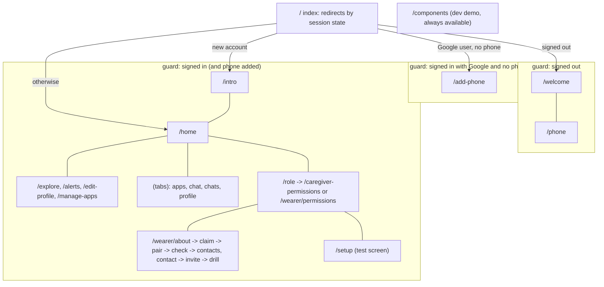

# 6. Routes, guards and state

## Routes (`app/`, Expo Router)

`app/_layout.tsx` wraps everything in providers (fonts, `SafeAreaProvider`, TanStack Query, `ThemeProvider`), starts the mocks if enabled, restores language,
display size and the saved session, then renders a `Stack` where **`Stack.Protected` guards** decide which screens exist for the current state.

| Route group / file                                                              | Who can reach it                      | Notes                                                                                        |
| ------------------------------------------------------------------------------- | ------------------------------------- | -------------------------------------------------------------------------------------------- |
| `app/index.tsx`                                                                 | everyone                              | Chooses the first screen from `useSession()`                                                 |
| `app/(auth)/welcome`, `phone`                                                   | signed out only                       | A1, A2                                                                                       |
| `app/add-phone.tsx`                                                             | Google sign-in without a phone number | A2; pending backend field                                                                    |
| `app/intro.tsx`, `home.tsx`, `explore`, `alerts`, `edit-profile`, `manage-apps` | signed in                             | `explore` and `alerts` are placeholders                                                      |
| `app/(tabs)/` `apps`, `chat`, `chats`, `profile`                                | signed in                             | Main app (wireframe D). Custom tab bar; opens on Apps. Wide web = sidebar + chat beside apps |
| `app/role.tsx`, `caregiver-permissions.tsx`                                     | signed in                             | B1, B3                                                                                       |
| `app/wearer/*`                                                                  | signed in                             | B2, C1-C8 (permissions, about, claim, pair, check, contacts, contact, invite, drill)         |
| `app/setup.tsx`                                                                 | signed in                             | Test landing until caregiver setup (D1+) is built                                            |
| `app/(dev)/components.tsx`                                                      | everyone                              | Component demo                                                                               |

Add a route: create the file in `app/`, then add `<Stack.Screen name="..."/>` in the correct guard group in `app/_layout.tsx`. A signed-out user is
pushed to `/welcome` automatically when the session clears. Use `features/nav/safeBack.ts` for back buttons so a deep link cannot dead-end.

## State: who owns what

| Kind                 | Tool                                                          | Examples                                                                                      |
| -------------------- | ------------------------------------------------------------- | --------------------------------------------------------------------------------------------- |
| Server data          | TanStack Query (`services/queryClient.ts`, one shared client) | reminders list, notes, Spotify status, news, conversations. Cleared when the person signs out |
| App and device state | Zustand stores                                                | see table below                                                                               |
| Saved on this device | `services/storage` / `secureStorage`                          | session, language, display size, news filters, drill history, manage-apps choices             |

Zustand stores:

| Store                                                          | Holds                                                                                                       | Saved? (key)                                                                                                                                                         |
| -------------------------------------------------------------- | ----------------------------------------------------------------------------------------------------------- | -------------------------------------------------------------------------------------------------------------------------------------------------------------------- |
| `services/auth/session.ts`                                     | tokens, user id, method, Google name, phone, intro flag                                                     | secure: `svaraa.session`, `svaraa.mobile.<userId>`                                                                                                                   |
| `features/household/store.ts`                                  | household id, role, setup step, `hasActiveDevice`                                                           | per user (loaded by `load(userId)`)                                                                                                                                  |
| `features/wearer/store.ts`                                     | wearer profile, contacts, pendant id                                                                        | per user                                                                                                                                                             |
| `features/wearer/drillRecords.ts`                              | SOS drill history (device only until a server endpoint exists)                                              | `svaraa.drillHistory`                                                                                                                                                |
| `features/settings/store.ts`                                   | theme mode, light/dark, display size, home background                                                       | Language (`svaraa.language`) and display size (`svaraa.displayScale`) are restored at start. **Light/dark and home background are not saved**: they reset on restart |
| `features/chat/store.ts`                                       | conversations and messages (text, errors, proposals); history comes from the server when `flags.ai` is real | no (memory)                                                                                                                                                          |
| `features/pendant/store.ts`                                    | live pendant status, reconnect                                                                              | no                                                                                                                                                                   |
| `features/news/store.ts`                                       | category, language                                                                                          | `svaraa.news.filters`                                                                                                                                                |
| `features/manage/store.ts`                                     | which apps are on (reminders, news, riddles, music), quiet hours (default 22:00-06:00)                      | `svaraa.manage-apps`                                                                                                                                                 |
| `features/reminders/store.ts`                                  | schedule sync (wearer phone, web member)                                                                    | no                                                                                                                                                                   |
| `features/reminders/alertsStore.ts`                            | answers to alerts (Done, Pending, ...)                                                                      | `svaraa.reminder-responses`                                                                                                                                          |
| `features/music/player.ts`, `youtubePlayer.ts`, `onePlayer.ts` | now-playing; one player at a time rule                                                                      | no                                                                                                                                                                   |

Session lifecycle (`useSessionEffects` in `app/_layout.tsx`): when a user id appears, the household and wearer stores load for that user; when it
disappears they unload **and the query cache is cleared**, so one person never sees another's data. The theme switches to `wearer` when the household role is
`wearer`. Per-person keys must include the user id, as `svaraa.mobile.<userId>` does.

Storage rules:

- Tokens and anything private: `secureStorage` (SecureStore on phones). Everything else: `storage`.
- **On web both use `localStorage`**, so tokens are readable by any script on the page. Treat as a known risk for production (the code comment says cookies from the backend are the plan).
- Mobile-only code in `.native.ts` with a `.web.ts` stub; the plain `.ts` file is the in-memory fallback used by tests and server rendering.
