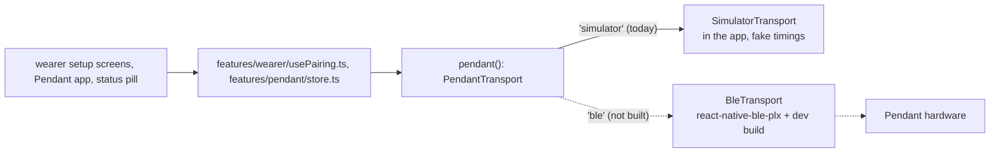
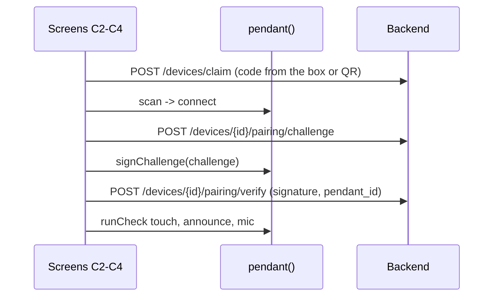
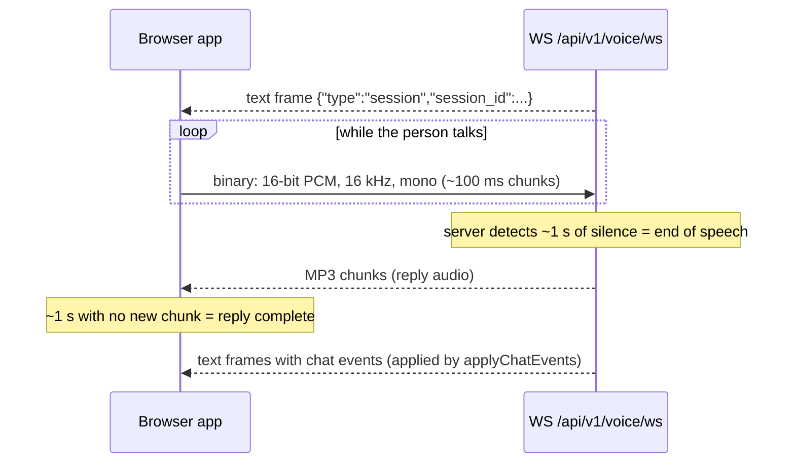

# 8. Pendant and voice

## Pendant: one interface, two transports

Screens and features never touch Bluetooth. They call `pendant()` from `services/pendant/`, which returns a `PendantTransport`. `flags.pendantTransport`
chooses the implementation:

Interface (`services/pendant/types.ts`):

| Method                                   | Purpose                                                                              |
| ---------------------------------------- | ------------------------------------------------------------------------------------ |
| `scan(onFound, options)`                 | Find pendants in pairing mode (gold dot pressed once); returns a stop function       |
| `connect(id)` / `disconnect()`           | Pair and connect; the pendant confirms with a tick and "Connected"                   |
| `signChallenge(challenge)`               | Sign the server's random challenge with the pendant's factory key (proof of genuine) |
| `runCheck('touch' / 'announce' / 'mic')` | The three C4 checks                                                                  |
| `getStatus()`, `onStatus()`              | `connection`, `battery`, `charging`                                                  |
| `onEvent()`                              | `pairing_press`, `sos` (gold button pressed 3 times)                                 |

Errors are `PendantError` with `pendant_not_found`, `pendant_connect_failed`, `pendant_not_connected` (also in the error code table).

### Setup flow against the server

The simulator signs with a `sim:` prefix and the mock backend accepts only that. Whether the real server accepts it depends on its dev setup (claim codes starting `MOCK`).

### Swapping in real Bluetooth (checklist)

1. Freeze the pendant spec with the hardware team: claim code / QR format (`features/wearer/claimCode.ts`), signature format, key upgrade, how the
   pendant's serial matches the claimed box, background behaviour. Update the `PENDING SPEC` comments in `types.ts`.
2. Add `services/pendant/ble.native.ts` implementing `PendantTransport` and a web stub that throws `pendant_connect_failed`.
3. In `pendant()` return it when `flags.pendantTransport === 'ble'` (today that branch throws).
4. Install `react-native-ble-plx` with `npx expo install`, add its config plugin, make a **new development build**.
5. Replace the "Bluetooth shown as allowed" shortcut in `services/permissions/wearerPermissions.native.ts` with a real permission check.
6. Test background connection (iOS can stop audio and Bluetooth when the phone locks; FE-10's background-audio test is still open).
7. Update `02-features.md` and `open-items.md`.

No screen should need to change; if one does, the interface is wrong.

## Voice

Three separate things share the word "voice":

| Thing                     | Where                                                      | State                                                                                  |
| ------------------------- | ---------------------------------------------------------- | -------------------------------------------------------------------------------------- |
| Dictation (mic in chat)   | `services/voice/dictation.web.ts`                          | Web only: the browser's speech to text, then `POST /chat/`. No backend call for speech |
| Talk call screen          | `voiceSocket.ts` (web), `voiceScripted.ts` (phones, tests) | Web talks to `WS /api/v1/voice/ws`; phones play a scripted demo                        |
| Pendant relay (Listening) | `features/apps/AppViews.tsx`                               | Not built: "Listening" always shows Off                                                |

### Socket contract (as implemented in `voiceSocket.ts`)

- Speech recognition on the server is **Hindi only** for now. There is no reply text and no "reply finished" marker.
- **The socket accepts no sign-in token yet** (and no `conversation_id`), so voice is not tied to the person's account; how it should take the token is open with the backend.
- The microphone is muted while Svaraa speaks, so it does not answer itself. A new call within 30 idle minutes continues the session (`lastSessionId`).
- Timeouts: connect 60 s (Render wake-up), 20 s with no reply returns to listening.
- Phones need a development build with native microphone streaming and audio playback before they can use the socket (`voiceSession.ts` is the swap point).
- Host: `env.wsUrl` (`EXPO_PUBLIC_WS_URL`, or the API host with `ws`).
