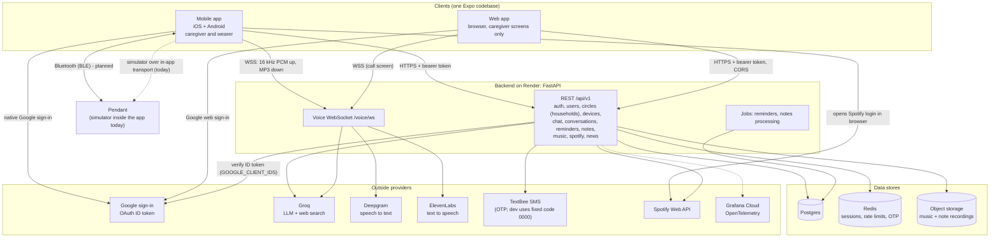
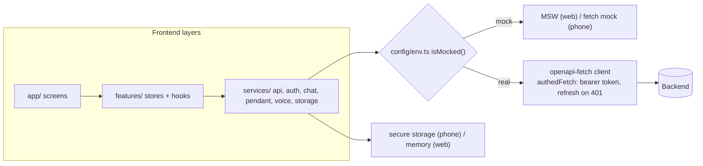
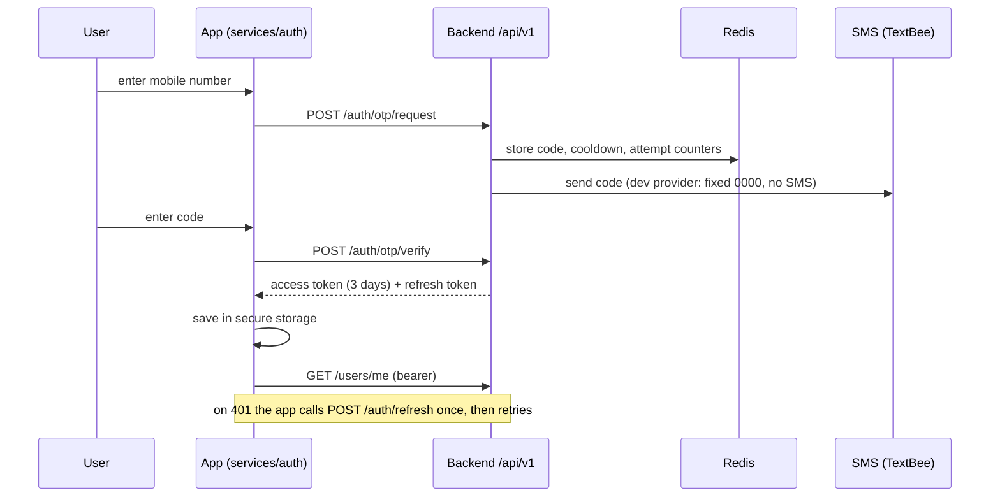
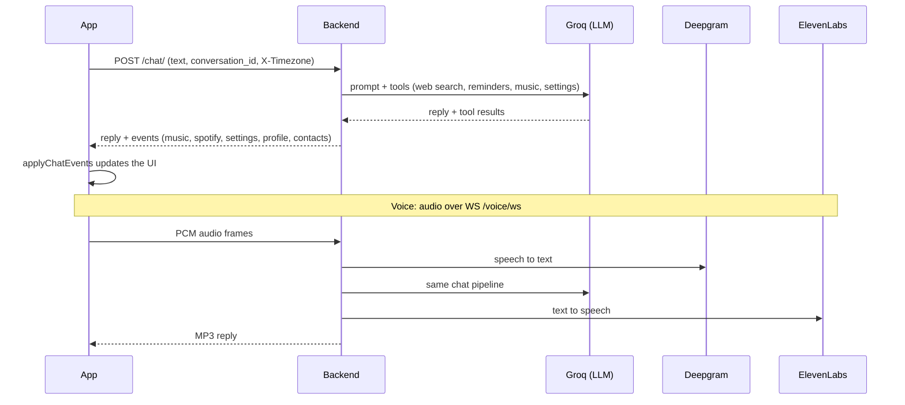
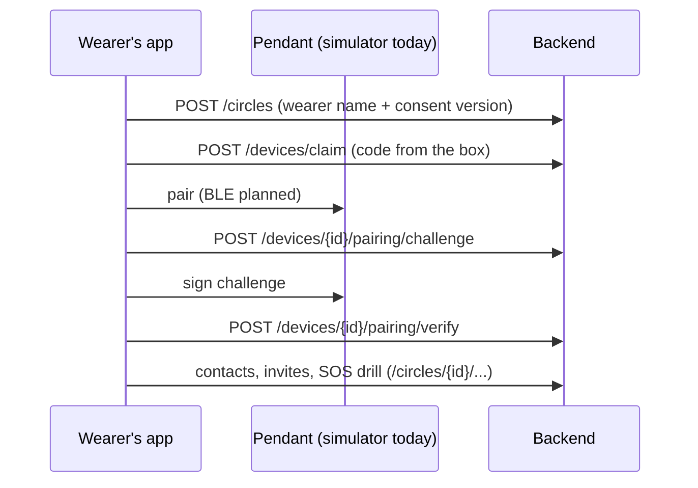
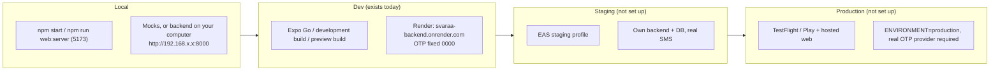

# Architecture

How the Svaraa app, web app, backend, voice socket, pendant and outside providers connect. Facts come from this repo, `docs/integration.md`,
`docs/open-items.md` and the backend repo's `README.md` and `.env.example` (Nov 2026). Items that are **planned, not built** are drawn dashed.

## 1. System diagram



Notes on the diagram:

- **One codebase, two clients.** The same Expo app builds for iOS, Android and web. Web is caregiver screens plus (planned) the setup-link
  landing page. It cannot talk to the pendant.
- **The phone is the pendant's gateway.** The pendant has no screen or internet of its own in this design; the wearer's phone pairs with it
  (the app stores the Bluetooth `pendant_id` when activating). Real BLE (`react-native-ble-plx`) is not built: `flags.pendantTransport`
  is `'simulator'`. See `services/pendant/`.
- **The app never holds a provider key.** Groq, Deepgram, ElevenLabs, TextBee, Spotify secrets and Supabase keys live only on the backend. The app
  holds only public `EXPO_PUBLIC_*` values (API URL, Google client IDs).
- **Voice.** The Talk screen streams microphone audio to `WS /voice/ws` and plays MP3 replies. Today the call view plays a scripted
  conversation (`services/voice/voiceSession.ts`) until the socket format and token handling are settled. Chat-mic dictation on web uses
  the browser's own speech to text and then `POST /chat/`.
- The backend and `docs/openapi.json` call a household a **circle**; only `services/household/` maps the two.

## 2. Inside the app



State: TanStack Query holds server data, Zustand holds app state, `expo-secure-store` holds the session on phones. On web the session is kept in
memory only, so a reload signs you out (see [Features](02-features.md)).

## 3. Data flows

### 3.1 Sign in with phone OTP



### 3.2 Sign in with Google

```mermaid
sequenceDiagram
  participant A as App
  participant G as Google
  participant B as Backend
  A->>G: sign in (web client ID; native SDK on phones)
  G-->>A: ID token
  A->>B: POST /auth/google (ID token)
  B->>G: verify; audience must be in GOOGLE_CLIENT_IDS
  B-->>A: Svaraa tokens
  A->>B: POST /auth/mobile/request + /mobile/verify ("Add your phone")
```

Web, iOS and Android client IDs must be in the same Google Cloud project and in the backend's `GOOGLE_CLIENT_IDS`.

### 3.3 Chat and voice



### 3.4 Wearer setup and pendant



### 3.5 Reminders

The caregiver creates reminders (`/circles/{id}/reminders`). The wearer's phone fetches `GET /circles/{id}/reminders/schedule` every
5 minutes, on app return and on demand. On web, an open page sets timers and shows a banner. **Phones do not ring yet**, and a closed web page
cannot alert (needs push, not built). See [Features](02-features.md).

## 4. Environments



| Environment | App config (`EXPO_PUBLIC_APP_ENV`) | Backend                                                         | Notes                                                                                                                |
| ----------- | ---------------------------------- | --------------------------------------------------------------- | -------------------------------------------------------------------------------------------------------------------- |
| local       | `local`                            | Mocks in the app, or your own backend (Docker Postgres + Redis) | Use your Wi-Fi IP on a phone; Android emulator `10.0.2.2`                                                            |
| dev         | `dev`                              | Render (free tier sleeps: first call 30-60 s)                   | Allows CORS only for `http://localhost:5173`. Fixed OTP `0000`. Notes uploads return 503 until storage is configured |
| staging     | `staging`                          | Not set up                                                      | Add an EAS profile ([Deployment](04-deployment.md))                                                                  |
| prod        | `prod`                             | Not set up                                                      | Backend refuses `ENVIRONMENT=production` without a real OTP provider. Hide dev OTP hint                              |

Today `EXPO_PUBLIC_APP_ENV` is read only as a label in `.env`; nothing in `config/env.ts` branches on it. Behaviour is chosen by the API URL, the
mock switches and `EXPO_PUBLIC_SHOW_DEV_OTP_HINT`.

## 5. Where secrets live

| Secret / key                                                                     | Lives in                       | Never in the app |
| -------------------------------------------------------------------------------- | ------------------------------ | ---------------- |
| `JWT_SECRET`, `DATABASE_URL`, `REDIS_URL`                                        | Backend env (Render)           | yes              |
| Groq, Deepgram, ElevenLabs, TextBee, Spotify client secret, Supabase service key | Backend env (Render)           | yes              |
| Google OAuth client IDs, API URL, WS URL                                         | App (`EXPO_PUBLIC_*`, public)  | n/a              |
| User tokens                                                                      | Phone secure store; web memory | n/a              |

## 6. Known gaps in this picture

- Web push / mobile push senders do not exist yet (`/me/installations` takes android and ios only).
- Telephony for SOS calls does not exist: the app only opens the dialer. Real SOS calling in order needs a backend service.
- The pendant's real protocol, signature format and claim-code format are open with the hardware team.
- Hosting for the web app and a staging/prod backend are undecided.
- I could not confirm from the backend repo which Postgres/object-storage vendor production uses (`.env.example` mentions Supabase for music and notes
  storage); the diagram says "Postgres" and "Object storage" generically. Correct this when the team confirms.
