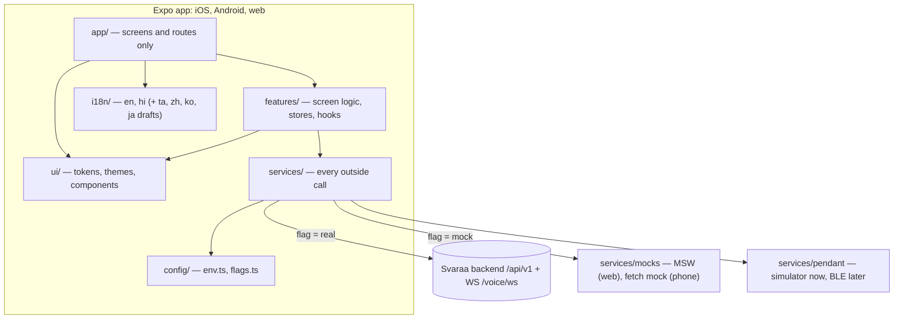

# Svaraa Core: frontend development guide

Versioned with the code: when you check out a tag, you get the docs that describe that tag.

| #   | Document                                         | Read it to...                                                       |
| --- | ------------------------------------------------ | ------------------------------------------------------------------- |
| 0   | [Architecture](ARCHITECTURE.md)                  | See how app, web, backend, voice, pendant and providers connect     |
| 1   | [Local setup](01-local-setup.md)                 | Run the app and web locally; set `.env`; choose mock or real        |
| 2   | [Features](02-features.md)                       | See each feature's status (done / partial / next version), limits   |
| 3   | [Extending guide](03-extending.md)               | Add a feature without conflicts                                     |
| 4   | [Deployment](04-deployment.md)                   | Make EAS builds and host the web build                              |
| 5   | [Backend integration](05-backend-integration.md) | Understand the API layer, errors, sessions, mocks, contract changes |
| 6   | [Routes and state](06-routes-and-state.md)       | See screens, auth guards, stores and what is saved on the device    |
| 7   | [Testing](07-testing.md)                         | Run and write tests; know what is not covered                       |
| 8   | [Pendant and voice](08-pendant-and-voice.md)     | Work on the pendant interface, simulator, BLE swap, voice socket    |
| 9   | [Languages](09-i18n.md)                          | Add text, check Hindi, add a language                               |
| 10  | [UI guide](../ui-guide/README.md)                | Use tokens, themes and components                                   |
| 11  | [Contributing](../../CONTRIBUTING.md)            | Branches, commits, PRs, hooks, CI                                   |

Related, older documents that stay as they are: [`frontend-plan.md`](../frontend-plan.md) (plan and tickets),
[`integration.md`](../integration.md) (per-endpoint backend status), [`open-items.md`](../open-items.md) (postponed work),
[`openapi.json`](../openapi.json) (API contract).

## Architecture in one picture

Rules that keep this shape (full list in [`CLAUDE.md`](../../CLAUDE.md)): screens never call the backend, Bluetooth, WebSocket or storage
directly; every string is in `i18n/`; colours come only from `ui/tokens.ts`.

## Tech stack

Expo SDK 58, React Native 0.88, React 19, TypeScript (strict), Expo Router, TanStack Query (server state), Zustand (app state),
`openapi-fetch` client generated from `docs/openapi.json`, MSW (mocks), i18next, Jest + Testing Library, ESLint, Prettier, Husky, commitlint.

## Terms

Always say **caregiver** (never "caretaker") and **household**. The backend and `docs/openapi.json` still call a household a **circle**
(`/circles/...`); only `services/household/` translates between the two. The people are the **caregiver** (manages) and the **wearer**
(uses the pendant).
