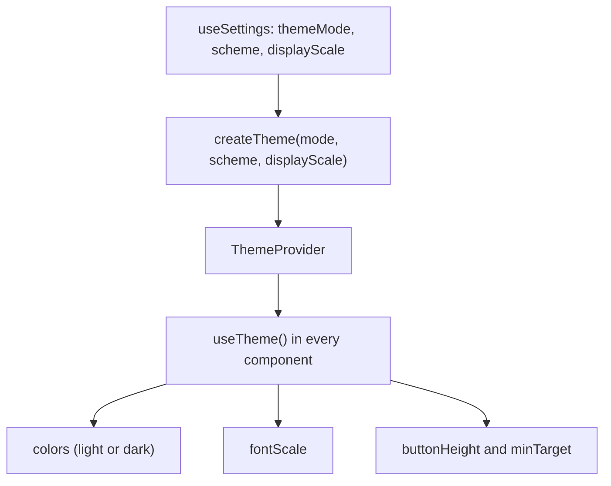

# Svaraa UI guide

The visual and component rules for the Svaraa app (iOS, Android, web). Written from the code, so it matches what ships.

- **Source of truth:** `ui/tokens.ts` (colours, space, radius, type, motion, shadow), `ui/theme.ts` (themes), `ui/*.tsx` (components).
- **Live view of every component and state:** the route `/components` (`app/(dev)/components.tsx`), in both themes and both languages.
- **Web CSS tokens** (`tokens.web.css`) are the website's original values, kept as the design reference. The app does not load them.
  The earlier Brand-document values are in `tokens.brand-doc-v1.css`. Token names are the same across all three.

> **Review note (Nov 2026).** The previous version of this guide described a web-only `@svaraa/ui` package (CSS `sv-*` classes,
> `AppShell`, `PendantChip`, `Dialog`, `Toast`...), which belongs to another repo (`Svaraa-V1`) and does not exist here. This version
> replaces it with the React Native components in `ui/`. Differences worth knowing: the app glass-surface alpha, radius and type sizes
> differ from the web file (the app is the reference for app work), and there is no Toast, Dialog, Badge or AppShell component.

## 1. Principles

- **Calm and warm.** Cream canvas, plum primary, soft glass cards.
- **One primary action per view.** Red (`safety`) only for safety.
- **Always a word.** Status is never colour alone: chips and cards carry a label.
- **Large and readable.** Body 15 px or more; tap targets 44 dp or more.
- **Two themes, same layout:** caregiver and wearer. **Wearer = larger text only. Buttons and tap targets are the same size in both.**
- **Light and dark schemes** with the same token names.
- **Every word is translatable.** No hard-coded text; `en` and `hi` are required.

## 2. Themes

| Property                | Caregiver    | Wearer              |
| ----------------------- | ------------ | ------------------- |
| `fontScale`             | 1            | 1.1                 |
| `minTarget`             | 44           | 44 (same)           |
| `buttonHeight` sm/md/lg | 36 / 44 / 48 | 36 / 44 / 48 (same) |

The Profile "display size" setting (levels 1, 2, 3) multiplies fonts by 1, 1.2, 1.3 on top of the theme. The wearer theme is selected
automatically when the household role is `wearer` (`app/_layout.tsx`). Components read everything through `useTheme()`; never branch on
the mode inside a component for sizes.

## 3. Tokens (`ui/tokens.ts`)

Never hard-code a colour outside this file. Colours come from `theme.colors`.

### Colour roles (light / dark)

| Role                 | Token                                          | Light                           | Dark                            |
| -------------------- | ---------------------------------------------- | ------------------------------- | ------------------------------- |
| Page background      | `canvas`                                       | `#FBF7F2`                       | `#18171A`                       |
| Glass card           | `surface`                                      | white 55%                       | `rgba(40,38,43,.48)`            |
| Solid card           | `surfaceSolid`                                 | `#FFFFFF`                       | `#242227`                       |
| Sunken area          | `sunken`                                       | plum 6%                         | black 28%                       |
| Brand block          | `brand`                                        | `#4A1532`                       | `#4A1532`                       |
| Body text            | `textPrimary`                                  | `#3A3340`                       | `#E9E3DC`                       |
| Secondary / tertiary | `textSecondary` / `textTertiary`               | `#6B6474` / `#7B7483`           | `#B3AAB3` / `#928A95`           |
| Headings             | `heading`                                      | `#4A1532`                       | `#F5EFE7`                       |
| Primary action       | `action` (`actionPressed`)                     | `#6F1D47`                       | `#E2BD72` (gold)                |
| Text on primary      | `onAction`                                     | `#FFF8F2`                       | `#22180C`                       |
| Accents              | `accentMemory`, `accentSpirit`, `accentItalic` | `#C8505B`, `#B88A44`, `#C8505B` | `#E8A0A6`, `#D9B065`, `#E6BF74` |
| Focus ring           | `focus`                                        | `#6F1D47`                       | `#E2BD72`                       |
| Borders              | `border`, `borderSubtle`                       | white 65% / plum 10%            | white 14% / 10%                 |
| Overlay              | `scrim`                                        | `rgba(34,9,26,.45)`             | `rgba(0,0,0,.6)`                |

### Status colours

Each has a strong colour and a `Tint` background. Use the pair together.

| Meaning   | Tokens                       | Use                                          |
| --------- | ---------------------------- | -------------------------------------------- |
| Good      | `good`, `goodTint`           | Connected, verified, done                    |
| Attention | `attention`, `attentionTint` | Low battery, late, needs a look              |
| Safety    | `safety`, `safetyTint`       | SOS, fall, recording, long offline           |
| Info      | `info`, `infoTint`           | Neutral notices                              |
| Solid red | `dangerSolid`, `onDanger`    | The safety button (white text), both schemes |

### Type (`typeScale`, in dp; multiplied by `fontScale`)

| Variant   | Face             | Size / line           | Weight |
| --------- | ---------------- | --------------------- | ------ |
| `display` | Newsreader       | 32 / 40               | 400    |
| `title1`  | Newsreader       | 26 / 32               | 400    |
| `title2`  | Newsreader       | 21 / 28               | 400    |
| `heading` | Inter            | 16 / 22               | 600    |
| `bodyLg`  | Inter            | 16 / 24               | 400    |
| `body`    | Inter            | 15 / 22               | 400    |
| `bodySm`  | Inter            | 13 / 18               | 400    |
| `label`   | Inter            | 14 / 20               | 500    |
| `caption` | Inter            | 12 / 16               | 400    |
| `kicker`  | Inter, uppercase | 11 / 14, tracking 1.2 | 500    |

The app is one step smaller than the web marketing sizes, for a compact app feel. Fonts load in `ui/fonts.ts`: Newsreader, Inter, and Noto
Sans for Devanagari, Tamil, Japanese, Korean and Simplified Chinese. `fontFamily()` and `scriptLineFactor()` pick the right face and
line height for the active language. Always render text through `<Text>` so this happens.

### Space, radius, motion, shadow

- Space (`space[1..8]`): 4, 8, 12, 16, 24, 32, 48, 64.
- Radius: `sm` 10, `md` 14, `lg` 18, `xl` 24, `xxl` 32, `full` 999.
- Motion: `quick` 120, `standard` 200, `gentle` 320 ms.
- Shadow: `card`, `raised` (plum shadow).
- Glass (`ui/glass.ts`, `glassStyle()`): kinds `panel`, `chrome`, `card`, `tile`. Blur on web, translucent fill on native.

## 4. Components (`ui/`, imported from `@/ui`)

| Component                                               | Purpose                                                                | Key props                                                                                                            |
| ------------------------------------------------------- | ---------------------------------------------------------------------- | -------------------------------------------------------------------------------------------------------------------- |
| `Text`                                                  | All text                                                               | `variant`, `tone` (primary, secondary, tertiary, heading, accent, spirit, onAction, safety), `italic`                |
| `Button`                                                | Actions                                                                | `label` (translated), `variant` primary / secondary / tertiary / safety, `size` sm / md / lg, `loading`, `fullWidth` |
| `Input`                                                 | Text field                                                             | `label`, `hint`, `error` + TextInput props                                                                           |
| `OTPInput`                                              | One-time code (`OTP_LENGTH`)                                           |                                                                                                                      |
| `Checkbox`, `Choice`, `MultiChoice`, `Option`, `Select` | Selection controls                                                     | `Choice`: `value`, `options`, `onChange`, `label`                                                                    |
| `Card`, `AttentionCard`                                 | Glass card; one problem with one action                                | `AttentionCard`: `title`, `detail`, `action`, `onAction`, `severity` info / attention / safety                       |
| `Chip`                                                  | Small status label                                                     | `label`, `tone` neutral / good / attention / safety / plain                                                          |
| `ListRow`                                               | Row with title, detail and a button or chevron                         | `title`, `detail`, `actionLabel`, `onPress`                                                                          |
| `Steps`, `StepList`                                     | Setup progress (revisit done steps, later locked); a list of steps     | `Step`: `id`, `label`, `done`, `locked`; `StepListItem` state done / now / todo                                      |
| `Tabs`                                                  | Segmented tabs                                                         | `TabItem`: `id`, `label`                                                                                             |
| `Sheet`                                                 | Bottom sheet (scrim, close button and Android back close it)           | `open`, `title`, `onClose`, `actions`                                                                                |
| `Screen`                                                | Page frame: safe areas, scroll, padding, readable width, pinned footer | `footer`, `bottomInset`, `transparent`, `maxWidth` (520 default)                                                     |
| `Icon`                                                  | Built-in SVG icon set                                                  | `name` (`IconName`), `color`, `size`                                                                                 |
| `Logo`, `LogoMark`                                      | Brand                                                                  | `height` / `size`                                                                                                    |
| `LanguageSwitch`, `SchemeSwitch`                        | Language and light/dark                                                |                                                                                                                      |

App-level building blocks (not in `ui/`) live in `features/main/` (top bar, tab bar, sidebar, drawer, columns, scene).

### Rules of use

- One `primary` Button per view; `safety` only for safety actions.
- Pass **already-translated** strings (`t('key')`) to `label`, `title` and similar props.
- Status uses `Chip`/`AttentionCard` with a word, never colour alone. Safety messages stay on top until acknowledged.
- Use the same four states everywhere: loading, empty, error, and (for the pendant) not connected. There is no shared component for these
  yet; reuse the same pattern as nearby screens and consider adding one in `ui/` (a small separate PR).
- Do-mode actions proposed in chat wait for the person's OK before running.
- Design rule (not enforced in code yet): pendant offline is grey, amber after 30 min, red after 2 h. Recording is always red.

## 5. Accessibility

- Every Button sets `accessibilityRole="button"`, an `accessibilityLabel` (defaults to its label) and busy/disabled state.
- Tap target 44 dp or more, same in both themes. Test with display size level 3 (fonts 1.3x) and the wearer theme.
- Focus: `Input` and `OTPInput` show the `focus` colour on the active field. `Button` and the other pressables have **no visible keyboard focus style yet**, which matters on web; add one in `ui/` (a small separate PR).
- Hindi and other scripts: check clipping, since line heights differ (`scriptLineFactor`).
- Respect reduced motion; animations use the `motion` durations.

### Known deviations from the rules

Review of Nov 2026: the rule "no hard-coded colours outside `ui/tokens.ts`" is **not fully met**. There are 86 hex literals in 13 files:
`features/games/*` (game art), `features/music/` (YouTube and Spotify brand colours and logos), `features/home/ProductCard.tsx`,
`features/main/palette.tsx` and `features/settings/homeBackground.ts` (page gradients), `features/wearer/MockPairingPendant.tsx`.
Third-party brand colours (Spotify, YouTube) and game art are acceptable exceptions; gradients and the product card should move to tokens
over time. Nothing enforces this: there is no lint rule for colours. For new code, use tokens, and put a comment on any literal explaining why.

## 6. Responsive behaviour

- Phone: single column; `Screen` caps content at 520 dp and centres it on wider windows.
- Web, wide window (`features/main/useWide.ts`, breakpoint 900 dp): header across the top, chat history as a sidebar, chat pane beside the apps (draggable
  between one and two thirds). Web is for caregiver screens only.
- Respect safe areas (`Screen` handles them).

## 7. Adding to the UI

1. Use tokens only. New colour: add it to `ColorSet`, `lightColors` **and** `darkColors` in `ui/tokens.ts` (and note it here).
2. Put reusable pieces in `ui/` and export them from `ui/index.ts`. Page-specific parts stay in `features/<name>/`.
3. Add the component and its states to `app/(dev)/components.tsx` and a test beside the others in `__tests__/components.test.tsx`.
4. Check: light and dark, caregiver and wearer, English and Hindi, a 360 px width, display size 3.
5. Changes to `ui/` go in a small separate PR (see [Extending guide](../development/03-extending.md)).
